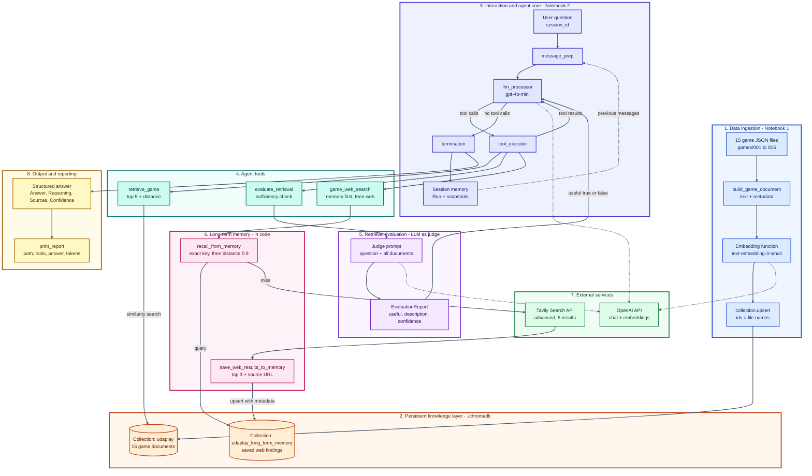

# UdaPlay: An AI Research Agent for the Video Game Industry


UdaPlay answers questions about video games, such as release dates, platforms, publishers and genres. It looks in a local ChromaDB knowledge base first, uses an LLM judge to decide whether that evidence is good enough, falls back to a web search when it is not, remembers what it learned for later sessions, and always returns a structured answer with sources and a confidence level.

> **Notebook names:** the notebooks in the verified run are called `part1_offline_rag_project.ipynb` and `part2_research_agent_project.ipynb`.

---

## Table of contents

1. [Highlights](#highlights)
2. [Architecture](#architecture)
3. [Project structure](#project-structure)
4. [Tech stack](#tech-stack)
5. [Dataset](#dataset)
6. [Getting started](#getting-started)
7. [How it works](#how-it-works)
8. [Example session](#example-session)
9. [Results](#results)
10. [Configuration reference](#configuration-reference)
11. [Requirements traceability](#requirements-traceability)
12. [Limitations and roadmap](#limitations-and-roadmap)
13. [Troubleshooting](#troubleshooting)
14. [References](#references)

---

## Highlights

- **Internal first, web second.** Every factual question starts with `retrieve_game`, then `evaluate_retrieval`. The web is used only when the judge returns `useful=False`.
- **Typed LLM judge.** A second `gpt-4o-mini` call returns a Pydantic `EvaluationReport` with `useful`, `description` and `confidence`.
- **Stateful state-machine agent.** Built on the supplied `lib.Agent`: `message_prep -> llm_processor <-> tool_executor -> termination`. Follow-ups such as "who published it?" are answered from session context with no tool calls.
- **Persistent long-term memory.** Web findings are saved with their source URLs. A brand-new agent answered the same question from memory with zero Tavily calls, cutting the turn from 16,420 to 6,906 tokens (58 percent).
- **Auditable output.** Each turn prints the state machine path, every tool call with a one-line result, the final answer and the token count. Answers always contain **Answer, Reasoning, Sources, Confidence**.
- **No edits to `lib/`.** Persistence is added by subclassing the supplied classes inside the notebooks.

---

## Architecture

The diagram shows the complete data science flow, from raw JSON files to a cited answer. Each group has its own colour palette (see the legend below the diagram).



### Colour legend

| Group | Palette | What it contains |
|---|---|---|
| 1. Data ingestion | Blue | JSON files, document builder, embeddings, upsert |
| 2. Persistent knowledge layer | Orange | Chroma collections `udaplay` and `udaplay_long_term_memory` |
| 3. Interaction and agent core | Indigo | User question, state machine steps, session memory |
| 4. Agent tools | Teal | `retrieve_game`, `evaluate_retrieval`, `game_web_search` |
| 5. Retrieval evaluation | Purple | Judge prompt and `EvaluationReport` |
| 6. Long-term memory | Pink | Recall and save helpers |
| 7. External services | Green | OpenAI API, Tavily Search API |
| 8. Output and reporting | Gold | Structured answer and per-turn report |

### Layers

| Layer | Responsibility |
|---|---|
| Interaction | Notebook `ask()` sends a question and prints a report |
| Agent | `lib.Agent` state machine around `gpt-4o-mini`, one `Run` object per turn and session |
| Tools | Three tools exposed to the model through JSON schemas generated by `@tool` |
| Knowledge | One persistent Chroma directory with two collections sharing one embedding model |
| Services | OpenAI (chat and embeddings) and Tavily (web search) |

### Decision workflow for one factual question

1. **Resolve follow-ups.** Rewrite pronouns into a self-contained question, or answer from context if the answer is already in the conversation.
2. **`retrieve_game`.** Return the five closest games with metadata and L2 distance (lower is closer).
3. **`evaluate_retrieval`.** The judge sees the question and all five documents and returns `useful`, `description`, `confidence`.
4. **Useful?** If yes, answer from the internal documents.
5. **Otherwise `game_web_search`.** Check long-term memory first (exact question key, then semantic distance at or below 0.9). On a miss, call Tavily and save the top three results with their source URLs.
6. **Answer** in the four-part format with sources and confidence.

---

## Project structure

```text
.
├── README.md
├── part1_offline_rag_project.ipynb   # Part 1: offline RAG (vector database)
├── part2_research_agent_project.ipynb   # Part 2: agent, tools, memory, reporting
├── games/                             # 15 JSON files (001.json ... 015.json)
├── lib/                               # Supplied library, not modified
│   ├── agents.py                      # Agent: state machine + session memory
│   ├── state_machine.py               # Steps, transitions, snapshots, runs
│   ├── tooling.py                     # @tool decorator and JSON schema builder
│   ├── llm.py                         # OpenAI chat wrapper
│   ├── messages.py                    # System, user, assistant, tool messages
│   ├── memory.py                      # ShortTermMemory (per session)
│   ├── long_term_memory.py            # LongTermMemory (vector-backed)
│   ├── vector_db.py                   # VectorStore and VectorStoreManager
│   ├── documents.py                   # Document and Corpus helpers
│   ├── rag.py, loaders.py, parsers.py, evaluation.py
│   └── __init__.py
├── chromadb/                          # Created at runtime (persistent storage)
├── .env  or  config.env               # API keys (never commit)
└── doc/UdaPlay_Technical_Report.pdf      # Full technical report (optional)
```

---

## Tech stack

| Area | Technology |
|---|---|
| Language | Python 3.11 or newer (verified on a 3.13 kernel) |
| LLM (agent and judge) | OpenAI `gpt-4o-mini`, temperature 0 |
| Embeddings | OpenAI `text-embedding-3-small` (1536 dimensions) |
| Vector database | ChromaDB `PersistentClient` |
| Web search | Tavily Python SDK |
| Validation | Pydantic |
| Config | `python-dotenv` |
| Runtime | Jupyter notebooks |

---

## Dataset

Fifteen games, one per platform, from 1990 to 2023. Each file has `Name`, `Platform`, `Genre`, `Publisher`, `Description` and `YearOfRelease`.

| # | Name | Platform | Genre | Publisher | Year |
|---|---|---|---|---|---|
| 001 | Gran Turismo | PlayStation 1 | Racing | Sony Computer Entertainment | 1997 |
| 002 | Grand Theft Auto: San Andreas | PlayStation 2 | Action-adventure | Rockstar Games | 2004 |
| 003 | Gran Turismo 5 | PlayStation 3 | Racing | Sony Computer Entertainment | 2010 |
| 004 | Marvel's Spider-Man | PlayStation 4 | Action-adventure | Sony Interactive Entertainment | 2018 |
| 005 | Marvel's Spider-Man 2 | PlayStation 5 | Action-adventure | Sony Interactive Entertainment | 2023 |
| 006 | Pokémon Gold and Silver | Game Boy Color | Role-playing | Nintendo | 1999 |
| 007 | Pokémon Ruby and Sapphire | Game Boy Advance | Role-playing | Nintendo | 2002 |
| 008 | Super Mario World | Super Nintendo Entertainment System (SNES) | Platformer | Nintendo | 1990 |
| 009 | Super Mario 64 | Nintendo 64 | Platformer | Nintendo | 1996 |
| 010 | Super Smash Bros. Melee | GameCube | Fighting | Nintendo | 2001 |
| 011 | Wii Sports | Wii | Sports | Nintendo | 2006 |
| 012 | Mario Kart 8 Deluxe | Nintendo Switch | Racing | Nintendo | 2017 |
| 013 | Kinect Adventures! | Xbox 360 | Party | Microsoft Game Studios | 2010 |
| 014 | Minecraft | Xbox One | Sandbox, Survival | Mojang Studios | 2014 |
| 015 | Halo Infinite | Xbox Series X|S | First-person shooter | Xbox Game Studios | 2021 |

Each file becomes one document with the text
`[Platform] Name (Year) - Description Genre: ... Publisher: ...`
and the full record stored as metadata, so questions about publishers and genres match the text and exact filters such as `Genre == "Racing"` still work. The file name is the document id, which makes re-indexing idempotent.

---

## Getting started

### Prerequisites

- Python 3.11 or newer
- An OpenAI API key (or the course gateway key) and a Tavily API key

### Install

```bash
python -m venv .venv
source .venv/bin/activate          # Windows: .venv\Scripts\activate
pip install chromadb openai tavily-python pydantic python-dotenv jupyter
```

### Configure

Create `.env` (or `config.env`) in the project root:

```bash
OPENAI_API_KEY="YOUR_KEY"
CHROMA_OPENAI_API_KEY="YOUR_KEY"     # optional, falls back to OPENAI_API_KEY
TAVILY_API_KEY="YOUR_KEY"
OPENAI_BASE_URL="https://openai.vocareum.com/v1"   # optional, course gateway default
```

If `OPENAI_BASE_URL` is not set, the notebooks default to the course gateway above. Remove or override it when using a regular OpenAI key.

### Run

Run the notebooks **in order**.

1. `Udaplay_01_starter_project.ipynb` builds the persistent `udaplay` collection and demonstrates semantic search. Run all cells.
2. `Udaplay_02_starter_project.ipynb` builds the tools, memory and agent, then runs the demo questions. Run all cells.

> On a Udacity workspace the first notebook cell swaps in `pysqlite3` for `sqlite3`. It is a no-op elsewhere.

---

## How it works

### Part 1: Offline RAG (`Udaplay_01`)

- `PersistentVectorStoreManager` subclasses the supplied `VectorStoreManager` (which is in-memory only) and writes to `./chromadb`, with a fixed embedding model and explicit API base.
- `GameVectorStore` adds `count()`, `upsert()` and `search()` helpers on top of `VectorStore`.
- The notebook demonstrates semantic search ("Who published Halo Infinite?" ranks Halo Infinite first at distance 0.7221), a metadata-filtered search, and a persistence check with a new manager instance.

### Part 2: Agent (`Udaplay_02`)

#### Tools

| Tool | Input | Output | Backend |
|---|---|---|---|
| `retrieve_game` | `query` | 5 games with metadata, distance, source | ChromaDB |
| `evaluate_retrieval` | `question`, `retrieved_docs` | `useful`, `description`, `confidence` | LLM judge |
| `game_web_search` | `question` | Memory hits, or up to 5 web results (title, url, content, score) | Long-term memory, Tavily |

`game_web_search` excludes `youtube.com`, `reddit.com`, `fandom.com` and `quora.com` to avoid user-generated content.

#### Agent and state machine

`build_agent()` creates a `lib.Agent` with the three tools and a system prompt that defines the workflow, forces self-contained follow-up queries, requires all retrieved documents to be passed unchanged to the judge, forbids unsupported claims and fixes the four-part answer format. A factory is used so a completely fresh agent can be created for the cross-session test.

#### Long-term memory

Saving and recall live **in code** inside `game_web_search`, not in the prompt. In the first three live runs the model skipped prompt-level memory instructions, so the behaviour was moved into code and passed in run 4.

| Step | Behaviour |
|---|---|
| Recall | Exact match on a normalised question key, then semantic search with distance at or below `0.9` |
| Save | Top 3 web results stored with `source_url` and `question_key`, duplicates skipped |
| Storage | Collection `udaplay_long_term_memory`, owner `udaplay-agent`, namespace `game-research` |
| Reset | `RESET_LONG_TERM_MEMORY = True` clears memory each run for a reproducible demo; set to `False` to keep it |

#### Reporting

`ask()` runs the agent with the library's step logging hidden and then calls `print_report()`, which prints for the current turn only: the question, the state machine path, each tool call with a result summary, the final answer and the token count.

---

## Example session

Abridged from live run 4. First, a question outside the dataset (web fallback):

```text
QUESTION: Was Mortal Kombat X released for PlayStation 5?
STATE MACHINE PATH: __entry__ -> message_prep -> llm_processor -> tool_executor -> llm_processor
                    -> tool_executor -> llm_processor -> tool_executor -> llm_processor
TOOL USAGE:
  [1] retrieve_game(query='Was Mortal Kombat X released for PlayStation 5?')
      -> Marvel's Spider-Man 2 [PlayStation 5, 2023] dist=1.0402; ...
  [2] evaluate_retrieval(question='...', retrieved_docs=<5 items>)
      -> useful=False (confidence 0.9) - The retrieved documents do not contain any
         information regarding Mortal Kombat X ...
  [3] game_web_search(question='...')
      -> WEB: Mortal Kombat X - Wikipedia <...>; Mortal Kombat X <store.playstation.com ...>
         [saved to long-term memory]

FINAL ANSWER:
**Answer:** Mortal Kombat X is playable on PlayStation 5, but it was originally released for PlayStation 4. ...
**Reasoning:** The web search confirmed that Mortal Kombat X can be played on PS5 ...
**Sources:** Wikipedia, PlayStation Store
**Confidence:** High
(tokens used this turn: 16420)
```

Then the same question to a **new agent in a new session**:

```text
  [3] game_web_search(question='...')
      -> LONG-TERM MEMORY HIT (no web call): ... (dist=0.3772); ... (dist=0.4038); ... (dist=0.4045)
...
(tokens used this turn: 6906)
CHECK: answered from long-term memory (no Tavily call).
```

---

## Results

### The five reported turns

| Turn | Tools called | Key evidence | Outcome | Tokens |
|---|---|---|---|---|
| Q1 Pokemon Gold and Silver release | retrieve, evaluate | dist 0.6528, useful=True, 0.9 | 1999 (Game Boy Color), internal sources | 4,501 |
| Q2 First 3D Mario platformer | retrieve, evaluate | dist 0.7884, useful=True, 0.9 | Super Mario 64, 1996 | 7,749 |
| Q3 Mortal Kombat X on PS5 | retrieve, evaluate, web | dist 1.0402, useful=False, 0.9 | Playable via the PS4 version, web sources | 16,420 |
| Q4 Follow-up on the first game | none | answered from context | Nintendo, Role-playing | 5,594 |
| Q5 Same as Q3, new agent | retrieve, evaluate, web (memory) | 3 hits, dist 0.3772 to 0.4045 | Same answer, no Tavily call | 6,906 |

### How the solution matured across live runs

| Run | Change before the run | Outcome |
|---|---|---|
| 1 | Persistent manager, reporting, memory tools in the prompt | Core met, memory never read, judge saw one document |
| 2 | Memory lookup in code, all documents to judge | Memory hit at 0.31, but duplicate and URL-less memory |
| 3 | Mandatory source URL, dedupe, domain exclusion | Agent skipped saving, no reuse |
| 4 | Saving and recall inside `game_web_search` | All tracked checks passed, memory reused |

**Takeaway:** behaviour that must always happen belongs in code, not in the prompt.

---

## Configuration reference

| Setting | Value | Purpose |
|---|---|---|
| Persist path | `./chromadb` | Storage for both collections |
| Game collection | `udaplay` | 15 game documents |
| Memory collection | `udaplay_long_term_memory` | Saved web findings |
| Embedding model | `text-embedding-3-small` | Must be identical in both notebooks |
| Chat model | `gpt-4o-mini`, temperature 0 | Agent and judge |
| Results per retrieval | 5 | Evidence given to the judge |
| `MEMORY_HIT_MAX_DISTANCE` | 0.9 (L2) | Semantic memory reuse |
| Web results saved | Top 3 | Bounded memory growth |
| Tavily | `advanced`, 5 results | Relevance over speed |

---

## Requirements traceability

| Project requirement | Where it is met | Status |
|---|---|---|
| Process game data into a persistent vector DB | Notebook 1, `PersistentVectorStoreManager`, 15 documents | Met |
| Semantic search | Notebook 1, four queries plus metadata filter | Met |
| `retrieve_game` tool | Notebook 2 | Met |
| `evaluate_retrieval` tool | Notebook 2, `EvaluationReport` schema | Met |
| `game_web_search` tool | Notebook 2, Tavily with memory-first lookup | Met |
| Internal first, evaluate, then web | Order observed in Q1, Q2, Q3 and Q5 | Met |
| Stateful agent as a state machine | `lib.Agent`, Q4 answered with no tools | Met |
| At least 3 queries with reasoning, tool use and cited answers | Five reported turns | Met |
| Store information for future use | Three memories with URLs, reused in Q5 | Met |

---

## Limitations and roadmap

| Limitation | Evidence | Next step |
|---|---|---|
| Tiny dataset | 15 games, one per platform | Expand data, add developers and ratings |
| Single-run evidence | One run of five turns | Repeat runs, build a labelled test set |
| Lenient judge | Q2 accepted without an explicit "first" | Stricter rubric, second judge, human audit |
| Prompt-enforced internal-first order | No code guarantee | Make each tool a state machine node |
| Uncalibrated thresholds | 1.0 boundary and 0.9 from few examples | Tune on labelled queries, consider cosine |
| Raw snippets in memory | Entries are search excerpts | Distil facts, add timestamps and expiry |
| Residual user content | A forum thread was saved in run 4 | Source allow-list, relevance score filter |
| Duplicated notebook code | Classes copied into two notebooks | Move to a shared module if `lib/` may change |
| Cost and latency | 16,420 tokens on the web turn | Basic search depth first, caching |

Privacy note: questions and saved snippets are sent to the model and search providers and stored unencrypted on disk. Do not use private questions in this configuration.

---

## Troubleshooting

| Symptom | Likely cause | Fix |
|---|---|---|
| `RuntimeError: The 'udaplay' collection is missing or empty` | Notebook 1 not run | Run `Udaplay_01` first |
| `AssertionError: ... is not set` | Missing key | Check `.env` or `config.env` and restart the kernel |
| Embedding or dimension errors after changing models | Collection built with another embedding model | Delete `./chromadb` and re-run Notebook 1 |
| `CHECK: memory was NOT reused` | Distance above the threshold | Raise `MEMORY_HIT_MAX_DISTANCE` toward 1.0 |
| Memory is empty at the start of each run | `RESET_LONG_TERM_MEMORY = True` | Set it to `False` to keep memories |
| Network or 401 errors | Wrong base URL for your key | Set or remove `OPENAI_BASE_URL` |

---

## References

All references were checked on 1 October 2026.

1. Lewis, P. et al. (2020). *Retrieval-Augmented Generation for Knowledge-Intensive NLP Tasks.* NeurIPS 2020. https://arxiv.org/abs/2005.11401
2. Yao, S. et al. (2023). *ReAct: Synergizing Reasoning and Acting in Language Models.* ICLR 2023. https://arxiv.org/abs/2210.03629
3. Zheng, L. et al. (2023). *Judging LLM-as-a-Judge with MT-Bench and Chatbot Arena.* NeurIPS 2023 Datasets and Benchmarks. https://arxiv.org/abs/2306.05685
4. Packer, C. et al. (2023). *MemGPT: Towards LLMs as Operating Systems.* https://arxiv.org/abs/2310.08560
5. Anthropic (2024). *Building effective agents.* https://www.anthropic.com/engineering/building-effective-agents
6. Chroma documentation: Collections. https://docs.trychroma.com/docs/collections
7. Chroma documentation: Python client reference. https://docs.trychroma.com/reference/python/client
8. Tavily documentation: Python SDK. https://docs.tavily.com/sdk
9. OpenAI documentation: Vector embeddings guide. https://developers.openai.com/api/docs/guides/embeddings
10. OpenAI documentation: Embeddings API reference. https://developers.openai.com/api/reference/resources/embeddings

For the full write-up, including figures, per-section analysis and the reference verification table, see [UdaPlay Technical Report](doc/UdaPlay_Technical_Report.pdf).
